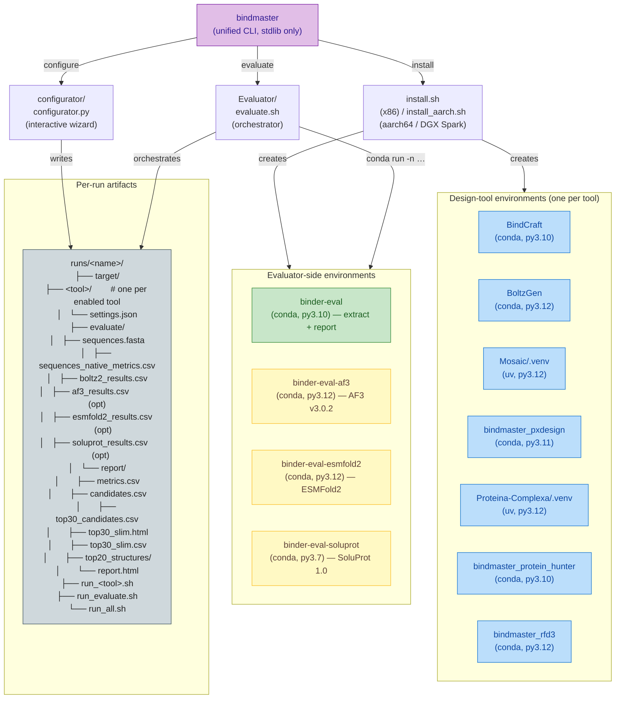

[](https://github.com/damborik22/BinderScout/actions/workflows/ci.yml)
[](LICENSE)
[](https://www.python.org/)
[]()

# BinderScout

A unified toolkit for GPU-accelerated protein binder design — installer, configurator, and evaluator in one repository.

> **Renamed from *BindMaster*.** This project was developed under the internal working name *BindMaster* and is now being released as **BinderScout**. The codebase still uses `bindmaster` in many places — the CLI command (`bindmaster install`, `bindmaster configure`, `bindmaster evaluate`), several conda env names (`bindmaster_pxdesign`, `bindmaster_protein_hunter`, `bindmaster_rfd3`), file and directory names (`bindmaster_examples/`, `bindmaster.py`), and environment variables (`BINDMASTER_*`). These are equivalent to the new name and will be migrated incrementally; functional behavior is unchanged. The GitHub remote is now `damborik22/BinderScout` (the old `damborik22/BindMaster` URL redirects).

> ### Recommended: run BinderScout through Claude Code
>
> This repository ships five [Claude Code](https://claude.com/claude-code) skills that
> drive the whole pipeline — target research, campaign planning, per-machine execution,
> cross-engine evaluation and the wet-lab handoff. **Open the repo in Claude Code and
> describe what you want**; the skills load automatically and assemble the CLI calls,
> the run directory and the right per-tool parameters for you.
>
> ```
> cd ~/BinderScout && claude
> > analyse PD-L1, then run a campaign with 10 designs per tool and rank the results
> ```
>
> Every step is a documented CLI command and the pipeline has **no runtime LLM
> dependency**, so nothing here is locked behind it — but the tools have a lot of
> sharp edges (per-tool hotspot requirements, gated AF3 weights, cross-engine gates,
> engine-specific metric biases), and the skills carry the knowledge of which ones
> matter when. See [Running with Claude Code](#running-with-claude-code).

> ### Use `master`
>
> **`master` is the only branch expected to be fully functional.** It is also where
> active development happens, and it supports both x86_64 and aarch64. Every other
> branch — currently only `v2.0.x` — is a development or maintenance line, may
> be mid-refactor, and is not guaranteed to install or run end to end. Unless you were
> pointed at one deliberately, clone `master` (the default).

---

## Project status, bugs and ideas

**BinderScout is under active development, and we would rather hear from you than not.**

This pipeline works — we have run complete campaigns with it, and the release you are
looking at is the state it was in when those campaigns ran. But it orchestrates seven
independent design tools and three structure-prediction engines, all of them moving
quickly and none of them ours. An upstream release can change a flag, a column name or a
model's memory profile without warning, and that is usually how something here breaks. So
we can say honestly that this was functional when we used it; we cannot promise that every
path is functional for you today, on your hardware, with this week's upstream versions.

**If you hit a bug, please tell us** — [open an issue](https://github.com/damborik22/BinderScout/issues).
A report costs you a few minutes and saves the next person the same afternoon. It is
genuinely useful even if you are not sure it is a bug, even if you cannot reproduce it
reliably, and even if you suspect you did something wrong: "I ran this and got that, and I
expected something else" is a complete and welcome report. What helps most, when you have
it to hand:

- the command you ran, and the error or the surprising output (a few lines is plenty)
- your platform and GPU, and whether the install is standalone or system-conda
- the relevant `runs/<name>/<tool>/settings.json`, which records the exact versions and
  parameters that produced the result

**Suggestions and ideas are just as welcome as bug reports.** A tool you would like
integrated, a metric you think the ranking is missing, a step that was confusing, a
default that fought you, documentation that sent you the wrong way, or a use case we
clearly never considered — all of it is useful, and the awkward feedback is usually the
most useful kind. Open an issue for those too; a rough thought is fine, you do not need a
worked-out proposal.

If you are considering a code contribution, see [CONTRIBUTING.md](CONTRIBUTING.md) — but
please do not feel you need to bring a patch. Telling us what went wrong is a real
contribution on its own.

---

## Components

| Component | What it does | Runs in |
|---|---|---|
| `bindmaster install` | Installs design tools (BindCraft, BoltzGen, Mosaic, PXDesign, Proteina-Complexa, Protein-Hunter, RFD3), all three refold engines (ESMFold2, Boltz-2, AF3) and the SoluProt solubility screen; AF3's env builds but its **weights are gated** and you request them yourself | bash |
| `bindmaster configure` | Interactive wizard: target → configs → run scripts | system Python |
| `bindmaster evaluate` | Passthrough to `binder-compare`: parse tool outputs, optionally screen with SoluProt, refold with Boltz-2 / AF3 / ESMFold2, rank by the cross-engine gate then consensus iPTM, generate HTML report | conda env `binder-eval` |

### Installed tools

| Tool | What it does | Environment | Platform |
|---|---|---|---|
| **BindCraft** | AF2 hallucination + ProteinMPNN + PyRosetta filtering | conda env `BindCraft` (Python 3.10) | x86_64 + aarch64 |
| **BoltzGen** | Boltz-1 diffusion structure generation | conda env `BoltzGen` (Python 3.12) | x86_64 + aarch64 |
| **Mosaic** | JAX / Boltz-2 gradient hallucination | uv venv `Mosaic/.venv` (Python 3.12) | x86_64 + aarch64 (no `esmj` wheel; `torchtext` may fail) |
| **PXDesign** | Protenix-based de novo design (diffusion + MPNN + AF2 eval) | conda env `bindmaster_pxdesign` (Python 3.11) | x86_64 + aarch64 |
| **Proteina-Complexa** | NVIDIA flow matching + inference-time optimisation (best-of-N, beam, MCTS) | uv venv `Proteina-Complexa/.venv` (Python 3.12) | x86_64. It **does install and generate on aarch64** — real two-chain designs, byte-reproducible on a GB10 — but no CUDA `jaxlib` exists there, so its only reward model (AF2) falls to the CPU and the production recipe costs ~12 days per replicate against ~2.25 h on one H200. A throughput verdict, not a broken build |
| **Protein-Hunter** | Boltz-2 / Chai-1 hallucination across 6 modalities (protein / cyclic / ligand CCD / ligand SMILES / DNA / RNA) | conda env `bindmaster_protein_hunter` (Python 3.10) | x86_64 — PyRosetta ships no aarch64 wheels |
| **RFD3** | RosettaCommons foundry diffusion (RFdiffusion3 + ProteinMPNN, BSD-3, commercial-use OK) | conda env `bindmaster_rfd3` (Python 3.12) | x86_64; installs on aarch64 but is **opt-in and unvalidated there** |

> Each tool runs in its own isolated environment. Environments must not be mixed.

### Evaluator engines & filters

The evaluator (`bindmaster evaluate` / `binder-compare`) runs on top of the design tools. Boltz-2 rides the Mosaic venv; ESMFold2 has its own env and is installed by default; AF3 is the canonical big-VRAM cross-check (separate install — gated weights). `evaluate.sh` auto-detects and runs whichever engine envs are present (`--skip-<engine>` to disable). SoluProt is a sequence-only solubility screen that runs **before** refolding so unsoluble designs can be dropped from the FASTA without burning GPU time.

| Engine / filter | Role | Environment | Platform | Install |
|---|---|---|---|---|
| **Boltz-2** | Primary refold engine; ranking reference | `Mosaic/.venv` (rides Mosaic install) | x86_64 + aarch64 | default (with Mosaic) |
| **ESMFold2** | Default refold engine; lightweight, no gated weights; also the `autosize` gate (`chain_iptm_interface`) | conda env `binder-eval-esmfold2` (Python 3.12) | x86_64 + aarch64 | default (in `--tool all`) |
| **AlphaFold 3 v3.0.2** | Canonical cross-engine 2nd opinion | conda env `binder-eval-af3` (Python 3.12, gated weights) | x86_64 + aarch64; fits a 24 GB card in our size regime — the gate is the **gated weights**, not VRAM | x86_64: in `--tool all` (the env builds, the **weights** you request yourself). aarch64: opt-in via `--tool af3` |
| **SoluProt 1.0** | Sequence-only *E. coli* solubility screen (Hon et al. 2021); filter, not a re-ranker | conda env `binder-eval-soluprot` (Python 3.7, scikit-learn 0.20.x) | x86_64 + aarch64. **Both platforms source-build USEARCH v12** (GPLv3; not redistributed here), so `--tool soluprot` needs a C/C++ toolchain — a failed build fails the install rather than leaving SoluProt silently unable to score. aarch64 additionally source-builds scikit-learn 0.20.4 and uses the `--no_tmhmm` model | in `--tool all` |
| **TmProt 1.0** | Sequence-only melting-temperature (Tm) prediction (Pailozian, Kohout *et al.* 2026); ESM-2 650M + LoRA. Advisory — nothing in the ranking reads it | conda env `binder-eval-tmprot` (Python 3.11, torch) | x86_64. Not wired into the aarch64 installer. GPU optional — a few hundred binders are minutes on CPU; predictions are cached per sequence | opt-in (`--tool tmprot`; pulls ESM-2 650M, ~2.5 GB) |

### Architecture

```mermaid
flowchart LR
    Input["Target structure\n(.pdb / .mmcif)"]
    Config["Configurator\nwizard → run scripts"]

    subgraph Design["Design tools (configurator domain — run via run_all.sh)"]
        BC["BindCraft\n(AF2 + MPNN + PyRosetta)"]
        BG["BoltzGen\n(Boltz-1 diffusion)"]
        MosaicT["Mosaic\n(JAX + Boltz-2 hallucination)"]
        PX["PXDesign\n(Protenix + MPNN + AF2 eval)"]
        PC["Proteina-Complexa\n(flow matching + ITO)"]
        PH["Protein-Hunter\n(Boltz-2 / Chai-1, 6 modalities)"]
        RFD3T["RFD3\n(foundry diffusion + MPNN)"]
    end

    Extract["Extractors\n(one per tool →\nunified FASTA +\nnative_metrics.csv sidecar)"]

    SoluProt["SoluProt 1.0\n(sequence-only solubility screen,\nbinder-eval-soluprot env;\nx86 + aarch64, in --tool all)"]

    Drop[("Drop\nbelow threshold\n(--soluprot-filter)")]

    subgraph Refold["Refolding engines (evaluator domain — independent cross-validation)"]
        Boltz2["Boltz-2\n(Mosaic venv;\nprimary engine)"]
        AF3["AF3 v3.0.2\n(binder-eval-af3;\ngated weights)"]
        ESMFold2["ESMFold2\n(binder-eval-esmfold2;\nlightweight, no gated weights)"]
    end

    Report["Report generator\nranked HTML + CSV\n(cross-engine gate →\nmean consensus iPTM;\nnative_* columns from extract)"]

    Input --> Config
    Config --> Design
    Design -->|tool-specific outputs| Extract
    Extract -->|FASTA of binders| SoluProt
    SoluProt -->|"filtered FASTA — only with --soluprot-filter"| Drop
    SoluProt -->|FASTA + soluprot_results.csv| Boltz2
    SoluProt --> AF3
    SoluProt --> ESMFold2
    Boltz2 --> Report
    AF3 --> Report
    ESMFold2 --> Report
```



All three refold engines are in `--tool all`, so a default install matches the report's default 3-engine gate. AF3 is included too: the installer builds its env and then prints where to request the weights from DeepMind, which are the one thing it cannot fetch for you — so AF3 is installed-but-weightless until you place them. ESMFold2 and SoluProt need nothing extra. All three engines are auto-detected by `evaluate.sh` from their conda envs. SoluProt acts as a filter, never as a re-ranker — it only drops designs with `--soluprot-filter` — its `soluprot_score` and `soluprot_passes` columns show up in `metrics.csv` alongside the refold scores so users can sort on them if they want.

### Components at a glance



Solid blue boxes are the seven design tools' isolated environments; green / yellow boxes are the four evaluator environments (all three engines ship in `--tool all`; AF3's env builds but its weights are gated and requested separately). The grey panel shows the per-run output layout the configurator generates and `evaluate.sh` fills in.

---

## Repository structure

```
BindMaster/
├── bindmaster.py               ← unified CLI dispatcher (system Python, stdlib only)
├── tui/
│   └── app.py                  ← interactive curses menu + numbered fallback
├── install/
│   ├── install.sh              ← x86_64 installer
│   └── install_aarch.sh        ← aarch64 / DGX Spark installer
├── configurator/
│   └── configurator.py         ← interactive setup wizard (steps 1–7, ~80 prompts)
├── evaluator_legacy/
│   └── evaluator.py            ← retired single-file evaluator (evaluate now → binder-compare)
├── Evaluator/                  ← bundled full evaluation pipeline package
│   ├── binder_comparison/      ← core Python package (extractors, refolding, scoring)
│   ├── scripts/                ← standalone refold scripts (refold_boltz2.py, refold_af3.py, refold_esmfold2.py)
│   ├── docs/                   ← pipeline reference, analysis notes
│   └── envs/                   ← conda env specs (binder-eval, binder-eval-af3 [gated weights])
├── .claude/
│   └── skills/                 ← Claude Code skills (target-analyst, orchestrator, worker,
│                                 evaluator, wetlab) — see "Running with Claude Code"
├── scripts/                    ← helper install scripts (PXDesign)
├── tests/                      ← unit + integration tests
├── docs/                       ← development plans, completed plans, environments reference, scientific notes
├── bindmaster_examples/        ← canonical run-script templates (Mosaic hallucination, RFD3, Protein-Hunter)
├── tools/
│   └── aarch64/                ← pre-built ARM64 binaries (dssp, DAlphaBall)
├── conda/                      ← local Miniforge3 (standalone mode, gitignored)
├── bin/                        ← local shortcuts (standalone mode, gitignored)
└── runs/                       ← generated run folders (gitignored)
```

Tool directories (`BindCraft/`, `BoltzGen/`, `Mosaic/`, `PXDesign/`, `Proteina-Complexa/`, `Protein-Hunter/`) are cloned by the installer and gitignored. RFD3 has no clone — it is pip-installed (`rc-foundry`) into `bindmaster_rfd3` and stores weights at `weights/foundry/`. AF3 v3.0.2 refolding runs in its own `binder-eval-af3` conda env on any CUDA host (measured ~4.4 GiB peak for 258-391 tokens, so a 24 GB card suffices; DGX Spark today; H200 / GH200 should also work); `refold_af3.py` is the canonical wrapper.

---

## Quick start

```bash
# 1. Clone (x86_64)
git clone https://github.com/damborik22/BinderScout.git ~/BinderScout
cd ~/BinderScout

# 2. Install tools — on a fresh clone call the script directly: the `bindmaster`
#    shortcut does not exist yet, because the installer is what creates it
./bindmaster.py install             # interactive menu
./bindmaster.py install --tool all  # install everything
#    This also installs a `bindmaster` shortcut into ~/.local/bin (on PATH by
#    default), so every command below can use the short form.

# 3. Configure a run
bindmaster configure

# 4. Run (scripts generated by configure)
bash runs/<name>/run_all.sh

# 5. Evaluate results — `bindmaster evaluate` forwards to the binder-compare CLI
#    (the configurator also writes runs/<name>/run_evaluate.sh, which drives Evaluator/evaluate.sh)
bash runs/<name>/run_evaluate.sh
# …or call the pipeline directly:
bindmaster evaluate run --mosaic runs/<name>/mosaic --bindcraft runs/<name>/bindcraft \
                        --target-seq "<TARGET_SEQ>" -o runs/<name>/evaluate
```

> **Prefer menus to flags?** Run `bindmaster` with no arguments for the interactive TUI —
> installer checkbox menu, configurator wizard, run launcher and status view.
> **[docs/walkthrough_and_dataflow.html](docs/walkthrough_and_dataflow.html)** reproduces
> every screen you will see, verbatim, and traces the full data flow: what each of the seven
> tools writes, which file and column the pipeline reads from it, and what happens to those
> numbers on the way to the report.

---

## `bindmaster` CLI reference

```
bindmaster install   [--tool bindcraft|boltzgen|mosaic|evaluator|pxdesign|proteina-complexa|protein-hunter|rfd3|all]
                     [--tool af3|soluprot]             # individually; both are also in --tool all
                     [--cuda VERSION] [--standalone] [--system-conda] [--yes] [--skip-examples]
                     [--skip-preflight] [--force]
bindmaster configure [options passed through to configurator.py]
bindmaster evaluate  <binder-compare args>             # passthrough, e.g. run / extract / report / autosize
bindmaster --help
```

### `bindmaster install`

On a fresh clone use `./bindmaster.py install …` — the `bindmaster` shortcut is created by
the first run of the installer (see [Quick start](#quick-start)).

Options:

| Flag | Description |
|---|---|
| `--tool all\|bindcraft\|boltzgen\|mosaic\|pxdesign\|proteina-complexa\|protein-hunter\|rfd3` | Which design tool(s) to install. Omit for interactive menu. |
| `--tool evaluator` | Evaluator pipeline only — the `binder-eval` conda env and the `binder-compare` CLI (already in `--tool all`). This is the one to use when someone else ran the designs and you only want to refold, rank and report them. |
| `--tool esmfold2` | ESMFold2 refolder — **default** (already in `--tool all`); lightweight, no gated weights; also the `autosize` gate. Listed here for explicit re-install. |
| `--tool af3\|soluprot` | Named individually to install just that engine. `af3` = AlphaFold 3 v3.0.2 — **in `--tool all`** as of this change, because leaving it out gave a default install two engines against a three-engine gate, so every design failed the gate. The install builds the env and smoke-tests it; the **weights are gated** and it prints where to request them rather than failing. `soluprot` = solubility screen, **already part of `--tool all`** (x86 needs the SoluProt + USEARCH downloads; **aarch64**: run `bash install/install_aarch.sh --tool soluprot` — it source-builds scikit-learn 0.20.4 + USEARCH v12 and uses the `--no_tmhmm` model). |
| `--cuda VERSION` | CUDA version for conda package resolution (default: 12.4) |
| `--skip-examples` | Do not prompt to run bundled examples after install |
| `--skip-preflight` | Skip the disk / GPU / network checks run before downloading |
| `--standalone` | Force local Miniforge3 install (no system conda needed) |
| `--system-conda` | Use existing system conda instead of local install |
| `--uninstall` | Remove tool environments, directories, and shortcuts |
| `--yes` / `-y` | Non-interactive mode (accept all defaults) |
| `--force` | Let `--yes` accept the destructive prompts too: re-clones tool repos and re-creates conda envs, **DELETING what is there — including `BindCraft/params/*.npz`, ~4 GB of AF2 weights**. Only for recovering a half-built environment. |

### `bindmaster configure`

Interactive wizard that:
1. Asks for a target name, PDB file, chain(s), and hotspot residues
2. Sets global binder length and design count, with per-tool overrides
3. Lets you enable/disable each current-generation tool (Mosaic, BoltzGen, BindCraft, PXDesign, Proteina-Complexa, Protein-Hunter, RFD3)
4. Writes all config files and shell scripts into `runs/<name>/`
5. Optionally runs the full pipeline immediately

```bash
bindmaster configure                                     # interactive wizard
bindmaster configure --status                            # all runs + completion state
bindmaster configure --archive <run>                     # tar.gz a run directory

# Headless: replay a saved config, no prompts at all
bindmaster configure --config runs/<name>/config.json
bindmaster configure --config my_run.json --run          # …and start the pipeline
```

Every wizard run writes its answers to `runs/<name>/config.json`, so a campaign is
reproducible without re-typing the interview: copy the file, edit what you want to
change (binder lengths, design counts, which tools), and replay it. Generation is
deterministic — a replay produces byte-identical run scripts. This is also the seam
any front-end should use: a GUI, a cron job or another script reads and writes this
file rather than re-implementing the wizard.

#### What gets generated

```
runs/<name>/
├── target/<name>.pdb
├── mosaic/
│   └── hallucinate.py          ← non-interactive, all params injected
├── boltzgen/
│   ├── config.yaml
│   └── outputs/
├── bindcraft/
│   ├── target_settings.json
│   ├── filters.json
│   ├── advanced.json
│   └── outputs/
├── pxdesign/
├── proteina_complexa/
├── protein_hunter/
├── rfd3/
├── run_mosaic.sh
├── run_boltzgen.sh
├── run_bindcraft.sh
├── run_pxdesign.sh
├── run_proteina_complexa.sh
├── run_protein_hunter.sh
├── run_rfd3.sh
├── run_evaluate.sh
└── run_all.sh                  ← runs all enabled tools in sequence
```

Each per-tool run script writes a `runs/<name>/<tool>/settings.json` capturing tool version, design parameters, target sequence, and GPU info before the design step begins — so a run is self-describing without grepping the parent script (which may have been edited since).

### `bindmaster evaluate`

Parses design outputs from any combination of tools, refolds them with independent
engines, ranks the pool, and writes a report. There is one ranking and no metric to
choose — see [Ranking metrics](#ranking-metrics) below.

**Refolding engines (canonical pipeline):**

| Engine | CLI subcommand | Env | Where it runs |
|---|---|---|---|
| **Boltz-2** | `binder-compare refold-boltz2` | Mosaic `.venv` | Anywhere with a 24 GB GPU |
| **ESMFold2** | `binder-compare refold-esmfold2` | `binder-eval-esmfold2` conda | Anywhere — lightweight, no gated weights. The default engine (`--tool all`), and the source of the `chain_iptm_interface` gate `autosize` uses. |
| **AF3 v3.0.2** | `binder-compare refold-af3` | `binder-eval-af3` conda | Any CUDA host — measured at ~4.4 GiB peak for 258-391 tokens, so a 24 GB card is enough; DGX Spark (aarch64), H200, RTX 3090, etc. The gate is the **gated weights**, not VRAM. |

Cross-engine columns are namespaced (`boltz_pae_*`, `af3_*`, `esmfold2_*`). There is **one ranking and no way to select another**: a cross-engine gate (`--min-engines`, default 3) then `consensus_iptm_mean`, emitted as a single `rank` column. `ipsae_min` (DunbrackLab 2025 formula) and `agreement_count` are diagnostic columns — `agreement_count` in particular is a flat null as a screen (macro-AUC 0.532), so do not gate on it. Part U removed the `--rank-by` / `--screen-metric` flags and the `two_stage_rank` / `adaptyv_rank` / `consensus_rank` / `active_rank` columns; see `docs/INVESTIGATION_partU_cao_benchmark.md`. AF3 and ESMFold2 produce token-order PAE which the evaluator transposes to match Boltz-2's `[binder|target]` order.

> Evaluation = Boltz-2 + AF3 + ESMFold2, exactly three independent engines. Each is auto-detected from its conda env and can be skipped with `--skip-<engine>`.

#### Usage — `bindmaster evaluate` forwards to `binder-compare`

`bindmaster evaluate <args>` runs the `binder-compare` CLI in the `binder-eval` conda env. The full pipeline (extract → refold → report) is one command:

```bash
binder-compare run --mosaic runs/PDL1/mosaic --bindcraft runs/PDL1/bindcraft \
                   --target-seq "MKTAYIAKQR…" -o runs/PDL1/evaluate
```

The configurator-generated `runs/<name>/run_evaluate.sh` wraps `Evaluator/evaluate.sh`, which auto-detects the installed engines and drives the whole thing.

Report output lands in `…/evaluate/report/`:

| File | Contents |
|---|---|
| `report.html` | The full report — plots, tables, per-engine comparisons |
| `metrics.csv` | All metrics, every row (the files below collapse duplicate designs to one representative) |
| `top30_candidates.csv` | The shortlist: top 30 distinct designs with sequences. **This is the file to script against** |
| `top30_slim.html` / `top30_slim.csv` | Decision-metrics tables — overall plus per-tool, all-metric roll-ups |
| `candidates.csv` | Per-tool native top-20 + refold top-50, with sequences |
| `top20_structures/` | Top-20 refolded complexes as PDB, plus a PyMOL session to load them |

#### `Evaluator/evaluate.sh` — the orchestrator's own flags

This is the script `run_evaluate.sh` calls, and the one to reach for when re-running a
step by hand. `bash Evaluator/evaluate.sh --help` prints the same list.

| Flag | Effect |
|---|---|
| `--sequences` / `--target-seq` / `--output` | Required: binder FASTA (or CSV / one-per-line), the full target sequence, the output directory |
| `--min-engines N` | How many independent engines must have refolded a design for it to be eligible for the ranking. Default 3 = all of Boltz-2 / AF3 / ESMFold2; floor 2. Designs below the gate are ranked **last, not dropped**. Never lowered automatically — see the warning note below |
| `--skip-boltz2` / `--skip-af3` / `--skip-esmfold2` | Skip an engine. Each is otherwise auto-detected from its conda env and skipped with a `[note]` if absent |
| `--af3-env` / `--esmfold2-env` / `--soluprot-env` / `--bindcraft-env` | Override the conda env name for that step |
| `--esmfold2-model full\|fast` | ESMFold2 checkpoint (default `full`) |
| `--skip-soluprot` / `--soluprot-threshold N` | Control the solubility screen (default threshold 0.5, the paper value) |
| `--soluprot-filter` | **Drop** sub-threshold designs from the FASTA before any refolding, saving GPU time. Off by default — the score lands in the report either way |
| `--primary-engine boltz\|af3\|esmfold2` | Which engine's metrics are promoted as primary (default `boltz`) |
| `--epitope-residues LIST` | Compute `epitope_match_fraction` inline against intended hotspots, e.g. `'15,18,232'`. Cheap, no extra pass |
| `--with-affinity` | Opt-in: after the report, run the \|dG/dSASA\| affinity ranking (Rosetta, BindCraft env) on the top 20 and regenerate |
| `--monomer-dir DIR` | Opt-in: binder-alone structures for the context-dependent-fold check (`fold_robust`) |
| `--allow-no-msa` | Proceed when the shared target MSA cannot be fetched. Default is to abort: one engine folding single-sequence while the others use an MSA produces scores that are not comparable, and the ranking averages across engines |
| `--resume` | Resume an interrupted run |
| `--concurrent` | Run the three refold engines staggered-concurrently instead of one after another. Worth ~1.25x (19.8 % wall-clock, measured), but it costs ~54 % of the OS memory headroom — use it only when the box is dedicated |
| `--stagger N` | Seconds between engine starts under `--concurrent` (default 30). Staggering stops three engines compiling at once |
| `--gpu-cap-boltz2` / `--gpu-cap-af3` / `--gpu-cap-esmfold2` | Per-engine CUDA MPS device-memory cap (defaults `24G` / `12G` / `24G`). On a unified-memory host (DGX Spark / GB10) the GPU pool **is** system RAM, so an uncapped engine reserves a fraction of the whole machine and can starve the OS. Caps are set at ~1.4-1.5x measured demand |
| `--no-gpu-guard` | Do not start the CUDA MPS guard. Only for hosts with a discrete card, where a runaway allocation kills the process rather than the machine |

> **The gate defaults to 3, and some hosts run two engines.** AF3 itself fits a 24 GB card
> for our size regime (~4.4 GiB peak at 258-391 tokens; the old ">=100 GB" figure was a
> preallocation artifact), but it needs gated weights, so a box without them runs
> Boltz-2 + ESMFold2 and *every* design fails a gate of 3.
> `evaluate.sh` counts the engines it will actually run and warns **before** any GPU
> time, naming the flag: pass `--min-engines 2`. It is never lowered for you — deriving
> the gate from whatever happens to be installed would make two operators with the same
> designs produce different rankings.

#### All `binder-compare` subcommands

Every one takes `--help`. `bindmaster evaluate <cmd> …` runs the same thing inside the
`binder-eval` conda env.

| Subcommand | What it does |
|---|---|
| `extract` | Pull binder sequences out of any combination of the seven tools' outputs into one FASTA |
| `parse-seqs` | Convert sequences from FASTA / one-per-line / CSV / comma-separated into FASTA |
| `validate` | Sanity-check sequences (alphabet, length, duplicates, target parse) before spending GPU time |
| `run` | The whole pipeline in one call: extract → refold-boltz2 → report |
| `report` | Merge the per-engine refold CSVs, rank, and write `report.html` + `metrics.csv` |
| **Refolding** | |
| `refold-boltz2` | Refold with Boltz-2 (Mosaic venv) |
| `refold-af3` | Refold with AlphaFold 3 v3.0.2 (`binder-eval-af3`; gated weights) |
| `refold-esmfold2` | Refold with ESMFold2 (`binder-eval-esmfold2`) — the default engine |
| **Screening before the GPU** | |
| `filter-soluprot` | Sequence-only *E. coli* solubility score (`binder-eval-soluprot`, no GPU) |
| `filter-tmprot` | Sequence-only melting-temperature (Tm) prediction (`binder-eval-tmprot`, GPU optional) |
| `prefilter` | Rank designs by a Boltz-2 fold-back interface score, for tools with no native metric (e.g. RFD3) |
| `autosize` | Decide whether enough independent designs cleared the ESMFold2 gate; size the next batch |
| **Campaign planning** | |
| `analyze-target` | Advisory target difficulty, suggested binder length, hotspots and batch size, from a PDB |
| `diversity` | Cluster designs into families by sequence identity (greedy, CD-HIT-style) |
| **Shortlist QC (all advisory — none of these reorder or drop)** | |
| `monomer` | Flag context-dependent folds: binder-alone vs in-complex Cα RMSD |
| `beta-check` | Flag binder→target β-sheet intercalation (β-augmentation) via DSSP cross-chain bridges |
| `epitope` | Compute `epitope_match_fraction` against an intended hotspot list |
| `epitope-map` | Interactive target structure coloured by binding frequency, with per-binding-mode toggles |
| `qc-annotate` | Interface-quality annotation of a shortlist (BindCraft panel; relax + Rosetta) |
| `affinity` | Rank affinity among binders via \|dG/dSASA\| gated by `ipsae_min` — **advisory, not validated** (Part N) |
| **Wet lab** | |
| `wetlab` | Markdown plan: synthesis, expression, assays, FASTA with biophysical properties |
| `hits` | Build the Selected Hits workbook from `candidates.csv` (top-N per tool + top-M refolded) |
| `mature` | Choose the next maturation round — strategy and parents — from returned binding data |

#### `autosize` — adaptive sampling

`binder-compare autosize` decides whether enough **independent** designs (backbones, not sequences) have cleared the ESMFold2 `chain_iptm_interface` gate, and sizes the next batch if not — single-shot verdict or a `--loop` that drives generate → refold → decide. Tier-aware gate (`--tier permissive|default|strict`) with a per-tool `--budget-cap`.

#### Ranking metrics

| Metric | Direction | Notes |
|---|---|---|
| `consensus_iptm_mean` | higher = better | **THE ranking** (after the cross-engine gate). Mean refold iPTM across engines — see above |
| `ipsae_min` | higher = better | Diagnostic / quality tier, **not** a sort key. min(bt, tb) iPSAE (DunbrackLab 2025) |
| `iptm` | higher = better | Interface pTM |
| `bt_ipsae` | higher = better | Binder-to-target iPSAE |
| `tb_ipsae` | higher = better | Target-to-binder iPSAE |
| `ranking_loss` | lower = better | Mosaic design-stage ranking loss |
| `plddt_binder_mean` | higher = better | Mean binder pLDDT |
| `pae_bt_mean` | lower = better | Mean binder-to-target PAE |

---

## Installer details

### Requirements

- Linux with an NVIDIA GPU (CUDA driver >= 12.1)
- `git` and `curl` available in PATH
- A C/C++ toolchain (`gcc`/`g++`, `make`) — `--tool all` includes SoluProt, which
  source-builds USEARCH v12 on both platforms, and a failed build **fails the install**
- ~75 GB free disk space for `--tool all`, to leave headroom. The preflight computes the
  figure per selected tool and **aborts** below it: 70 GB for `all`, or 71 if it also
  installs its own Miniforge3. `--skip-preflight` overrides
- Conda/Miniforge is **not required** — the installer downloads Miniforge3 automatically if needed

### What happens during install

Each tool goes through:
1. **Clone** — repo cloned at a pinned commit into `BinderScout/<Tool>/`
2. **Environment** — conda env or uv venv created (spinner + full log)
3. **Smoke test** — minimal import or `--help` call
4. **Example** (optional, skippable) — bundled example run
5. **Shortcut** — launcher written to `BinderScout/bin/`

### Reproducibility: `install/locks/`

Tool repositories are cloned at pinned commits, but the pins that actually broke this
project three times were *transitive* — `pip install pyrosetta` picking up 2026.29,
`uv pip install atomworks` picking up 3.0.0, `pip install ruff` picking up 0.17. The
installer names a couple of dozen packages; the environments hold anywhere from ~25 to
~236 distributions each (measured on the capture host), and the unnamed remainder is where
those outages came from.

So every verified environment is captured into `install/locks/<env>.txt` (plus Mosaic's
`uv.lock`) and fed back to pip as a constraints file on reinstall. `install/locks/EVIDENCE.md`
records where each capture came from.

Two limits worth knowing before you rely on it: the locks are **x86_64 only** —
`_constraints()` refuses to apply them on another architecture — and they cover 10 of the
11 environments. `binder-eval-af3` has none: its pins have not been captured
yet. (`EVIDENCE.md` long said the env was absent on the capture host, which was wrong — it
exists there and produced the PD-L1 AF3 refolds.)

### Non-interactive options

```bash
bash install/install.sh --tool all --yes --skip-examples
bash install/install.sh --tool mosaic
bash install/install.sh --cuda 12.1
bash install/install.sh --tool all --yes --force        # replace existing checkouts/envs
bash install/install.sh --tool all --yes --skip-preflight
bash install/install.sh --uninstall --tool all
```

> **`--yes` is safe to re-run.** It auto-confirms the *safe* prompts ("Proceed with
> installation?", "Run the example?") but auto-answers **no** to the destructive ones
> — re-cloning a tool repo, re-creating a conda env, removing the local Miniforge3 —
> so a repeat install keeps existing checkouts and downloaded weights. Add
> **`--force`** to accept those too, which will delete what is there (including
> `BindCraft/params/*.npz`, ~4 GB of AF2 weights).
>
> ```bash
> bash install/install.sh --tool all --yes            # first install, or safe repair
> bash install/install.sh --tool pxdesign --yes       # resumes; reuses the existing env
> bash install/install.sh --tool pxdesign --yes --force   # rebuilds it from scratch
> ```
>
> A **preflight check** runs before any download: free disk against a per-tool
> estimate (aborts if short), GPU presence and pypi.org reachability (advisory).
> `--skip-preflight` bypasses it.

### Server / HPC installation (no admin required)

BinderScout works fully standalone — no system conda, no admin, no writes outside the project directory:

```bash
git clone https://github.com/damborik22/BinderScout.git
cd BinderScout
python3 bindmaster.py install --tool all --yes

# Add to PATH:
export PATH="$(pwd)/bin:$PATH"
echo 'export PATH="/path/to/BinderScout/bin:$PATH"' >> ~/.bashrc
```

The installer auto-detects if system conda is unavailable or read-only and downloads
Miniforge3 into `BinderScout/conda/`. All environments and shortcuts stay inside the
project directory. To remove everything: `rm -rf BinderScout/`.

---

## Platform / branch

**Clone `master`.** It carries both installers and is the only branch expected to be
fully functional:

| Platform | Installer | Status |
|---|---|---|
| x86_64 Linux + NVIDIA GPU | `install/install.sh` | the tested configuration — all seven tools and three refold engines are exercised here |
| NVIDIA DGX Spark / Grace-Hopper (aarch64) | `install/install_aarch.sh` | supported, with the caveats in [aarch64 notes](#aarch64-notes). **For 1.0.6 this path is ported and reviewed, not release-tested on hardware** — its fixes were developed and exercised on the `v2.0.x` line, but no Spark install was run against this tree. Two tools are x86-only for external reasons (Protein-Hunter: no PyRosetta aarch64 wheels; Proteina-Complexa: no CUDA `jaxlib`), so "all seven tools" is an x86_64 statement. Its version pins are **not** captured in `install/locks/` — those are x86_64 captures and `_constraints()` refuses to apply them on another architecture |

```bash
git clone https://github.com/damborik22/BinderScout.git ~/BinderScout
cd ~/BinderScout
./bindmaster.py install        # the `bindmaster` shortcut only exists after this
# or: bash install/install.sh          (x86_64)
#     bash install/install_aarch.sh    (aarch64 / DGX Spark)
```

There is **no separate `aarch64` branch** — aarch64 support lives on `master` next to
the x86_64 installer. Earlier revisions of this section advertised
`git clone -b aarch64 …`, which fails: no such branch exists on the remote.

### Other branches

`v2.0.x` is the active development line: it is not guaranteed to install or run end to
end, and work lands on `master` first. Use `master` unless you were pointed at `v2.0.x`
deliberately. (`v1.1.x` was a midpoint line, retired and deleted on 2026-10-29; the tag
`archive/v1.1.x` keeps it reachable.)

### aarch64 notes

- **BindCraft**: ARM64 binaries (`DAlphaBall.gcc`, `dssp`) bundled in `tools/aarch64/` — copied automatically. Runs on the GPU as of 1.0.1: the installer pins `jax[cuda12]==0.6.2`, the first jaxlib whose LLVM knows `sm_121`. On the older 0.4.34 pin any real AF2 forward pass aborts with `LLVM ERROR: Unsupported rounding mode for conversion`. Older text here said it was blocked by missing aarch64 jaxlib CUDA packages; that was wrong — those exist, the problem was the LLVM target. For aarch64.
- **BoltzGen**: PyTorch from the **cu130 wheel index**, pinned (`torch==2.10.0+cu130`). Plain PyPI torch is **CPU-only** on aarch64 for the versions we pin — an earlier note here said the opposite, and acting on it silently replaces a working CUDA build with a CPU one.
- **Mosaic**: `esmj` excluded (no aarch64 wheel). `torchtext` may also fail (no Linux aarch64 wheel).
- **PXDesign**: Full pipeline works on aarch64 / Blackwell. The installer applies automatic patches for CUDA arch compatibility (sm_120) **and `-std=c++20`** (torch >= 2.9 headers hard-error on c++17, so protenix's fused kernel will not build without it), JSON serialization (`NumpyEncoder`), **`use_bfloat16=False` in the AF2 eval** (jaxlib's AArch64 backend cannot lower a bf16 convert under SVE, so the eval subprocess SIGABRTs and surfaces only as a `JSONDecodeError` on an empty file), and dataloader (`num_workers`) config. PyTorch must come from the **cu130** index; a cu124 build reports `torch.cuda.is_available() == True` and then fails every kernel launch.
- **Proteina-Complexa**: **Deprecated on aarch64 — not viable, not broken,** and the reason given here before was wrong. PyG and `torchtext` were never the blocker: Proteina-Complexa imports neither. Upstream installs and *generates* fine on Spark — it has produced real two-chain designs on GB10 / sm_121, and re-running the same config 16 days later reproduced them byte-identically, so treat "deprecated" as a statement about throughput and nothing else. The blocker is that **no CUDA `jaxlib` exists for aarch64**, so the AF2 reward — the only member of its composite objective — runs on CPU at ~320 s/call against ≤2.46 s on an H200. The production recipe (`mcts`, `n_simulations=8`) fixes the budget at 3,300 AF2 calls per 100-design replicate: **12.2 days on Spark vs 2.25 h on one H200**. Threading does not help — AF2-on-CPU asymptotes at ~4 of 20 cores. Run it on x86. Do **not** "fix" this by switching to `best-of-n`: that is cheap only because it never consults the reward during generation, and MCTS was adopted because it beat best-of-n 10× at iPTM ≥ 0.85 in ⅓ the wall clock. **Not wired into `install_aarch.sh`** — `--tool proteina-complexa` there exits with that explanation.
- **Protein-Hunter**: **Not supported on aarch64** — PyRosetta has no aarch64 wheels. `install_aarch.sh` rejects `--tool protein-hunter` with that reason.
- **RFD3**: `install_aarch.sh --tool rfd3` installs it (cu130 torch wheels, `rc-foundry[rfd3,mpnn]`, weights + ProteinMPNN checkpoint into `weights/foundry/`). Opt-in rather than part of `--tool all` because it is **not yet validated on aarch64 hardware**.

> **aarch64 tool matrix.** `install/install_aarch.sh` accepts `all`, `bindcraft`,
> `boltzgen`, `mosaic`, `evaluator`, `pxdesign`, `rfd3`, `af3`, `esmfold2`,
> `soluprot`. `--tool all` installs BindCraft, BoltzGen, Mosaic, Evaluator, PXDesign
> and **ESMFold2** (the default refold engine).
>
> - **RFD3 is opt-in on aarch64:** `--tool rfd3`. It is pure pip with no DGL
>   dependency so it should work, but it has **not been validated on aarch64
>   hardware** — which is why it is not in `--tool all`. Please report results.
> - **Protein-Hunter and Proteina-Complexa are refused** with an explicit reason
>   (PyRosetta has no aarch64 wheels; PyG/torchtext may not either).
> - `bindmaster install` now selects the installer for the host architecture
>   automatically, so you no longer need to invoke `install_aarch.sh` by hand — the
>   TUI's "Install tools" does the same.
- **AF3 refolding**: Live on aarch64 / DGX Spark via the `binder-eval-af3` conda env and `binder-compare refold-af3`. Not aarch64-exclusive — AF3 runs anywhere with a CUDA GPU — measured at ~4.4 GiB peak for 258-391 tokens, so a 24 GB card is enough (H200, GH200, RTX 3090 all work); DGX Spark is just our primary host because Spark is where the unified memory headroom lives.

---

## Shortcuts

After installation, launchers are available in `BindMaster/bin/`:

```bash
bindmaster         # unified CLI (install / configure / evaluate)
bindcraft          # activates BindCraft conda env, cd to BindCraft dir
boltzgen           # activates BoltzGen conda env, cd to BoltzGen dir
mosaic             # activates Mosaic uv venv, cd to Mosaic dir
pxdesign           # activates PXDesign conda env
complexa           # activates Proteina-Complexa venv
protein-hunter     # activates Protein-Hunter conda env
rfd3               # runs `rfd3 design ...` or opens the bindmaster_rfd3 env shell
evaluate           # runs Evaluator/run.sh wizard
bindmaster-config  # runs configurator directly (legacy)
```

---

## Reinstalling a tool

```bash
bindmaster install --tool bindcraft
```

Answer **Y** when prompted to remove the existing directory and conda environment.

---

## Monitoring installs

```bash
tail -f ~/BinderScout/install.log         # x86_64
tail -f ~/BinderScout/install_aarch.log   # aarch64
```

---

## Troubleshooting

**BindCraft smoke test fails**
Check `BindCraft/params/` contains `.npz` weight files. If the AF2 download was interrupted, reinstall.

**BoltzGen model download fails**
BoltzGen downloads Boltz-1 weights (~6 GB) on first use. Re-run — it resumes automatically.

**`uv` not found after Mosaic install**
```bash
source ~/.bashrc
```

**`bindmaster evaluate` — Mosaic must be installed**
```bash
bindmaster install --tool mosaic
```

**A tool failed, others succeeded**
```bash
bindmaster install --tool <toolname>
```

**Checking what's installed**
```bash
conda env list                    # shows conda-managed envs
ls BindMaster/bin/                # shows shortcuts
ls BindMaster/conda/envs/         # shows local envs (standalone mode)
```

---

## Known issues

A full read-only audit of the repository was run on 2026-07-26 — purpose, data flow,
dependencies, defects, non-LLM operability and GUI options, 31 findings with file:line
and a suggested fix order. Every finding it raised against the quick-start path (F1, F2,
F3, F5, F8, F9, F15, F20, F33, F34, F38, F40, F41) has since been fixed, and the tables
that listed them as live issues were removed rather than left to mislead.

The audit document itself does not ship: it was dropped by the history rewrite that made
this repository public. `docs/walkthrough_and_dataflow.html` is the surviving companion
piece, and is likewise a snapshot rather than current documentation — see the banner at
the top of it.

**No known issues are open against the documented quick-start path.** If you hit one,
the fastest useful report is the failing command, `install.log` (or `install_aarch.log`),
and `git rev-parse --short HEAD` from the repository root.

The items below are what is still true today.

### Things worth knowing before you run it

Not defects — behaviour that will surprise you if you have not met it.

- **The cross-engine gate defaults to 3, and most hosts run two engines.** AF3 fits a
  24 GB card, but needs **gated weights**, so a box without them runs Boltz-2 + ESMFold2 and *every* design
  fails a gate of 3 — ranked last, no shortlist. `evaluate.sh` says so before spending
  any GPU time and names the flag; pass `--min-engines 2` to rank on the engines you
  have. It is never lowered for you: deriving the gate from whatever happens to be
  installed would make two operators with the same designs produce different rankings.
- **Enable only tools that report `installed`.** The configurator refuses to generate a
  run whose enabled tools are missing their assets, listing each one and the install
  command, before writing anything. Nothing is half-built, but the run is not generated
  either.
- **Hand-written `--config` files are validated, not guessed at.** Missing keys are
  listed by name up front. Start from a `runs/<name>/config.json` the wizard wrote and
  edit values rather than composing one from scratch.
- **`run_all.sh` does not stop at the first casualty.** A tool that dies is recorded and
  the rest continue; the Evaluator reports on whatever finished; the script exits
  non-zero at the end naming the failed steps. Check that summary line — a "complete"
  run and a run that lost BoltzGen both produce a report.

### Correctness caveats worth knowing

- **The ranking is computed from PAE `.npy` files, not from the CSV's `iptm` column.**
  If a results directory is separated from the refold CSVs that reference it (a
  `fleet.sh fetch`, an archived run, a CSV copied on its own), the per-engine ipTM and
  ipSAE columns cannot be recomputed. The report says so — `[pae] N/N PAE files … were
  not found`, then `[rank] NO engine ipTM was available` — and the resulting `rank`
  column carries no cross-engine signal. Move the whole `evaluate/` directory, not just
  the CSVs.
- **The ranking is a triage filter, not a decision procedure.** On a realistic
  same-target, same-tool pool (Cao 2022: 4,442 designs, 12 targets) the top decile is
  worth roughly 1.5–2× enrichment, and it beats a random ordering on only 6 of 12
  targets. It ranks binder-vs-non-binder confidence, never affinity among binders.
  See Part U in [CHANGELOG.md](CHANGELOG.md).

### Running with Claude Code

BinderScout ships five [Claude Code](https://claude.com/claude-code) skills under
`.claude/skills/`. Open the repository in Claude Code and they load automatically —
describe what you want in plain language instead of assembling the CLI calls yourself.
They cover the campaign end to end, each handing off to the next:

| Skill | What it does | Say something like |
|---|---|---|
| `bindmaster-target-analyst` | Researches the target before any compute is spent — literature, known binders, pockets, epitopes, PTM sites — then runs the geometric difficulty analysis and proposes hotspots, binder lengths, per-tool N and a gate tier | *"analyse PD-L1 before we start"* |
| `bindmaster-orchestrator` | Plans the campaign, picks which tool suits the target, writes the run directory, dispatches to this machine, an HPC cluster or a LAN fleet, and tracks `PROGRESS.md` across machines | *"start a campaign on PD-L1"*, *"what should we run next"* |
| `bindmaster-worker` | The per-machine execution layer: pre-flight checks, env setup, job submission, monitoring the per-tool source-of-truth files, packaging results | *"run the assignment"*, *"check progress on BM2"* |
| `bindmaster-evaluator` | Cross-engine refold (Boltz-2 + AF3 + ESMFold2), the iPTM consensus ranking, the HTML/CSV report, interface-energy affinity ranking, and monomer/fold QC | *"rank the designs"*, *"which are the best"* |
| `bindmaster-wetlab` | Turns ranked designs into an order: codon-optimised gene FASTA, expression conditions, a BLI/SPR/FIDA test panel and controls — then plans the next maturation round from the binding data | *"prepare the wet-lab plan"*, *"we got Kd results — what next"* |

The skills carry the operational knowledge that is tedious to rediscover: which tool
fits which target, what the ranking metrics do and do not mean, and the failure modes
behind the caveats above. They are the recommended way to run a campaign.

They are not required — see below.

### Running without an LLM

The executable pipeline has **no runtime LLM dependency** — the `.claude/skills/`
packages are an operating manual, not a requirement. Every step above is a plain
CLI call documented in this README, and scripted use is covered end to end:

- **The configurator has a headless mode.** Every wizard run writes
  `runs/<name>/config.json`, and `configurator --config <file>` regenerates a run
  directory with no prompts (`--run` also starts the pipeline). Replays are
  byte-identical.
- **All 22 `binder-compare` subcommands are documented**, under
  [All `binder-compare` subcommands](#all-binder-compare-subcommands), and a test fails
  if the table and the parser disagree in either direction. `--help` on any subcommand
  remains the detailed reference.

---

## Development

See [CONTRIBUTING.md](CONTRIBUTING.md) for code style, testing, and PR conventions.

### Linting

```bash
ruff check .                # Python lint
ruff format --check .       # Python format check
shellcheck --shell=bash --severity=warning install/install.sh install/install_aarch.sh
```

### Testing

```bash
docker build -f Dockerfile.test --target base -t bindmaster-test .
docker run --rm -it bindmaster-test bash
./test_env.sh --dry-run     # non-interactive validation
./test_env.sh --gpu         # with GPU
```

---

## License

[MIT](LICENSE) — covers BindMaster's own source (CLI, configurator, TUI,
installers, `binder-comparison`).

It does **not** cover the third-party assets redistributed in this tree: the
NGL viewer, the SoluProt distribution, and the ARM64 `DAlphaBall.gcc` / `dssp`
builds. Those carry their own terms — see
[THIRD_PARTY_NOTICES.md](THIRD_PARTY_NOTICES.md). The GPLv3 USEARCH binaries
that used to ship here have been removed; both installers now build USEARCH v12
from source as part of `--tool soluprot`.

The design tools and refolding engines are fetched by the installer rather than
redistributed here; their licences travel with them.
